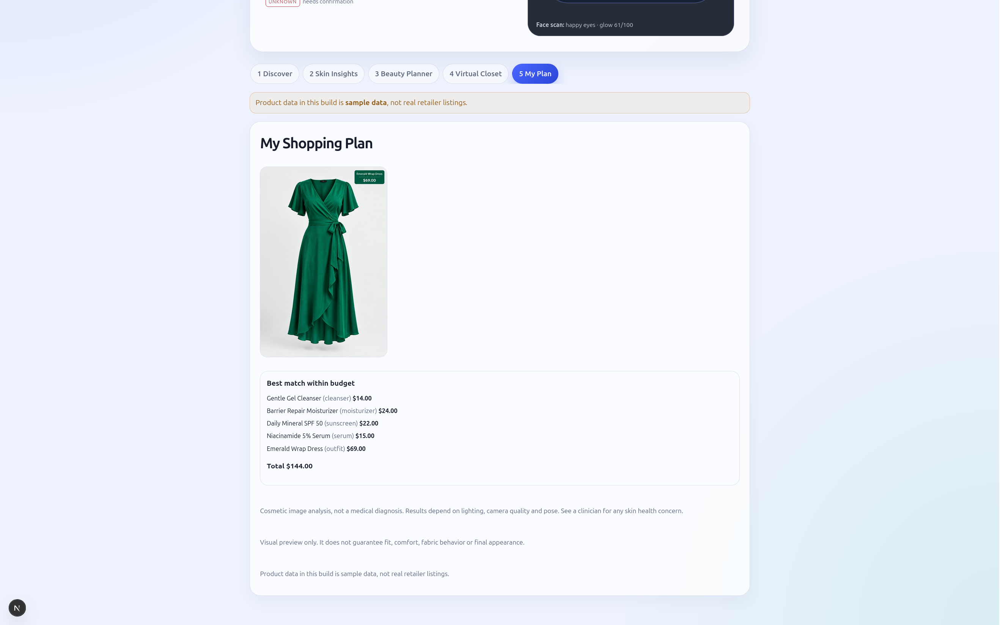

# DermaStyle AI



DermaStyle AI is a skin-first shopping assistant that combines a structured shopping goal, AI skin analysis, recommendation logic, and a virtual try-on preview. It is built as a FastAPI backend and a Next.js frontend, with the backend owning the YouCam API key and the frontend calling backend endpoints through the same-origin `/api/*` proxy route.

## What the app actually does

1. Parses a natural-language shopping goal into a structured profile.
   - Detects occasion, budget, fragrance-free / alcohol-free requests, style tags, desired categories, and whether the user wants an outfit.
   - Stores the parsed preferences in a session and allows the shopper to edit them.

2. Collects explicit consent and analyzes a face photo with YouCam Skin AI.
   - Requires a consent checkbox before running skin analysis.
   - Validates image type, size, and orientation before upload.
   - Normalizes EXIF metadata, strips location data, and never writes uploaded photos to disk.

3. Recommends skincare products based on the user’s goal and measured skin concerns.
   - Each recommendation includes evidence labels such as `measured`, `verified`, `catalog`, `inferred`, and `unknown`.
   - Fragrance-free logic is strict: if ingredient information is missing or the list includes fragrance terms, the product is treated as ineligible or unknown instead of being assumed clean.
   - Budget-aware product bundles are built from the ranked catalog.

4. Runs a garment try-on using the YouCam cloth-v4 flow.
   - Accepts either a garment ID from the catalog, a public HTTPS garment URL, or an uploaded product image.
   - Validates the body photo and the garment image before calling the API.
   - Produces a preview URL that is shown in the plan.

5. Builds a final plan with bundles and a selected garment preview.
   - The plan includes total price, "within budget" status, notes, and the chosen try-on preview.
   - Sample data warnings are surfaced when the catalog is unverified.

## Important product constraints in the code

- The app is intentionally deterministic and rule-based; it does not invent product facts.
- No medical claim is made from skin results. The app displays a skin-analysis disclaimer.
- Virtual try-on results are always shown as a visual preview only.
- Session state is in memory and expires after 6 hours by default.
- There is no authentication, user accounts, or payments flow in the current implementation.
- The catalog is sample data by default. The app warns the user when the dataset is not fully verified.

## App flow and endpoint model

The backend exposes a session-based API with job polling for long-running AI tasks.

### Session lifecycle

- `POST /api/sessions` creates a session.
- `GET /api/sessions/{session_id}` reads the session state.
- `POST /api/sessions/{session_id}/goal` stores the raw goal and parsed preferences.
- `PUT /api/sessions/{session_id}/prefs` allows edits to the parsed profile.
- `DELETE /api/sessions/{session_id}/data` clears photo-derived results and resets the session.
- `GET /api/sessions/{session_id}/events` returns the event log.

### Health and catalog

- `GET /api/health` returns app health and whether the catalog is sample data.
- `GET /api/catalog/products` lists products.
- `GET /api/catalog/products/{product_id}` gets one product.
- `GET /api/catalog/garments` lists garments.

### AI jobs and recommendations

- `POST /api/sessions/{session_id}/skin` starts a YouCam skin analysis job.
- `GET /api/jobs/{job_id}` polls the job state.
- `GET /api/sessions/{session_id}/recommendations` returns ranked product recommendations.
- `POST /api/sessions/{session_id}/tryon` starts a garment try-on job.
- `GET /api/sessions/{session_id}/plan` builds the final plan and bundle totals.

## Frontend user journey

The frontend is a five-step flow:

1. Discover
2. Skin Insights
3. Beauty Planner
4. Virtual Closet
5. My Plan

The browser captures or uploads a face photo, submits it to the backend, waits for the job result, then generates a recommendation set and optional garment preview. It also performs client-side camera checks for brightness and framing before uploading a live selfie.

## Architecture

### Backend

- `backend/app/main.py` creates the FastAPI app and CORS middleware.
- `backend/app/api/routes.py` defines the routes and validation logic.
- `backend/app/agent/preferences.py` parses natural-language goals.
- `backend/app/agent/recommender.py` scores recommendations against the skin report and product constraints.
- `backend/app/agent/budget.py` builds budget-aware bundles.
- `backend/app/agent/workflow.py` defines the session pipeline and legal stage transitions.
- `backend/app/catalog/` contains product and garment models, catalog loading, and ingredient checking.
- `backend/app/media/validation.py` validates uploaded photos and strips EXIF metadata.
- `backend/app/youcam/` handles file registration, upload, task creation, polling, and typed errors.

### Frontend

- `frontend/app/page.tsx` implements the main workflow UI.
- `frontend/lib/api.ts` contains the frontend API client and polling helper.

## Run locally

### Prerequisites

- Python 3.12+
- Node.js 22+
- Docker and Docker Compose (optional)

### 1) Configure environment

At the repository root, create a `.env` file from the example:

```bash
cp .env.example .env
```

The app expects a YouCam API key in the backend configuration. The example file contains a sample key and the following settings:

```env
YOUCAM_API_KEY=...
# Optional overrides:
# YOUCAM_BASE_URL=https://yce-api-01.makeupar.com
# CORS_ORIGINS=http://localhost:3000
# MAX_UPLOAD_MB=10
```

The backend loads this root-level `.env` file automatically through `backend/app/config.py`.

### 2) Run the backend

```bash
cd /path/to/dermastyle-ai
python -m venv .venv
source .venv/bin/activate
pip install -r backend/requirements.txt
cd backend
uvicorn app.main:app --reload --host 0.0.0.0 --port 8000
```

The API will be available at:

- http://localhost:8000
- Swagger docs: http://localhost:8000/docs

### 3) Run the frontend

In a second terminal:

```bash
cd /path/to/dermastyle-ai/frontend
npm install
npm run dev
```

The UI will be available at:

- http://localhost:3000

### 4) Run with Docker Compose

```bash
cd /path/to/dermastyle-ai
cp .env.example .env
docker compose up --build
```

This starts:

- backend on port 8000
- frontend on port 3000

## Static file and data notes

- The product catalog is loaded from `backend/data/catalog.json`.
- `Catalog.is_sample` is true whenever any product is not marked `provenance.verified`.
- The sample catalog warns the user that the data is not verified retailer data.
- Garment entries may not have public image URLs; when they do not, the API requires an uploaded product photo or `https` garment image before try-on is allowed.

## YouCam integration details

The backend follows the YouCam file-task polling pattern used by their API:

1. `POST /s2s/v2.0/file` registers a file and returns a `file_id` and a pre-signed upload URL.
2. `PUT <pre-signed-url>` uploads the binary data.
3. `POST /s2s/v2.0/task/{skin-analysis|cloth-v4}` creates the task and returns a `task_id`.
4. `GET /s2s/v2.0/task/{feature}/{task_id}` polls until the task succeeds or fails.

The client uses a retry strategy with jittered backoff for transient 429/5xx/network failures and a strict deadline while polling.

## Testing

The project includes backend tests that mock the YouCam API calls using `respx`.

```bash
cd backend
pytest -q
```

The frontend also has a production build check:

```bash
cd frontend
npm run build
```

## Current project status

- Verified: backend tests cover session creation, parsing, image validation, skincare recommendation logic, and end-to-end mocked YouCam flows.
- Verified: frontend TypeScript build passes in the project setup.
- Not yet live-verified: real YouCam requests with an actual API key. The code is prepared for those calls, but the live API contract should be checked against the current YouCam response schema before a production demo.
- This is a prototype and not yet production-hardened for real user data or commerce features.

## Project layout

```text
backend/
  app/
    agent/
    api/
    catalog/
    media/
    youcam/
    config.py
    deps.py
    jobs.py
    main.py
  data/
  tests/
  requirements.txt
frontend/
  app/
  lib/
  package.json
.env.example
docker-compose.yml
README.md
```
